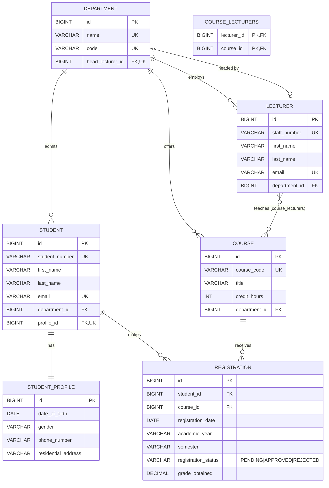

# Entity Relationship Diagram (ERD)

This ERD reflects the entities, attributes, and relationships implemented in the JPA model.

## Cardinality Notes
- **Department 1:N Student**: each student is assigned to exactly one department.
- **Department 1:N Lecturer**: each lecturer is employed by exactly one department.
- **Department 1:N Course**: each course belongs to exactly one department.
- **Department 1:1 Lecturer (head)**: each department has one head lecturer; `head_lecturer_id` is unique.
- **Student 1:1 StudentProfile**: `profile_id` is unique and required.
- **Lecturer M:N Course**: implemented with join table `course_lecturers` (no separate entity).
- **Student M:N Course via Registration**: implemented as join entity `registrations` because it stores registration date, academic year, semester, status, and grade.
